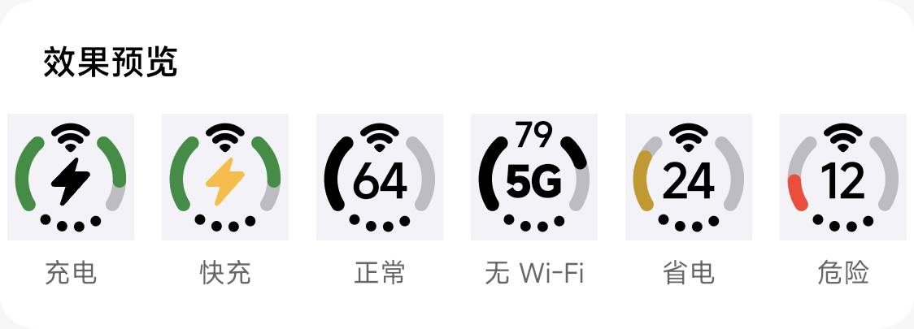
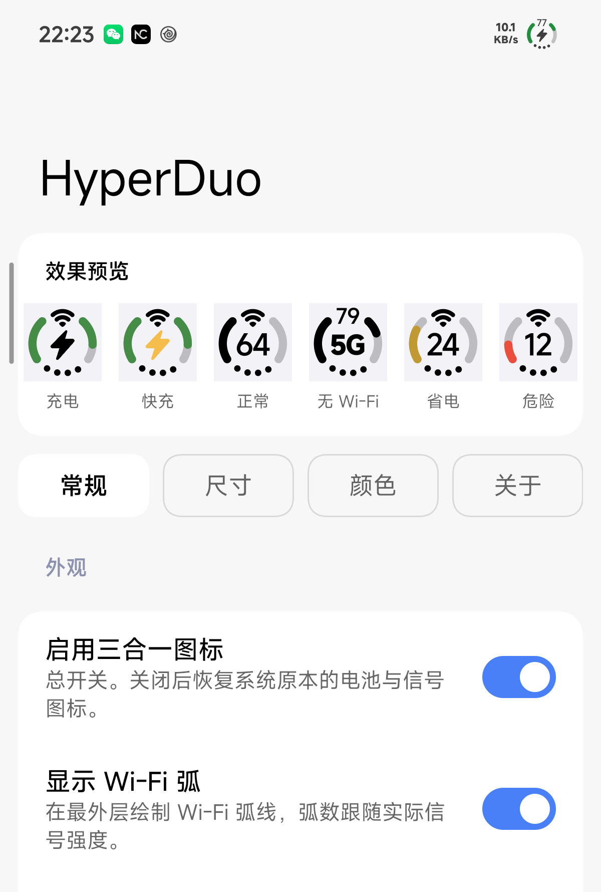

# HyperDuo

把状态栏里的 **Wi-Fi、移动信号、电量** 合并成一个仿 iPhone「Duo」风格的三合一图标。


HyperDuo 是一个 LSPosed 模块，只作用于系统界面（`com.android.systemui`）。开启后，状态栏
右上角原本分开的 Wi-Fi 图标、信号格与电池图标会被替换成一个整体字形：

- 外圈是**电池环**，缺口在下方，按电量点亮；
- 环里是 **Wi-Fi 弧线**，弧数跟随真实信号强度；
- 底部是**移动信号点**，四个点表示移动网络信号强度；
- 环内是**电量数字**，充电时变成闪电（快充为琥珀色闪电）。



从左到右：充电、快充、正常、无 Wi-Fi（显示网络类型）、省电、危险。

## 它能做什么

### 每一笔都可以换掉

环里的每一样东西——电量数字、Wi-Fi 弧、移动信号点、网络类型、充电闪电——都可以单独换成别的，
或者干脆**交还给系统**。关掉 Wi-Fi 弧，原生 Wi-Fi 图标就回到状态栏原本的位置；关掉移动信号点，
原生信号格回来。每个开关都是「用三合一的画法」和「用系统原本的画法」之间的切换，不是简单地
少画一笔。

### 一个位置可以放好几样，按顺序顶上

图标的上、中、下三个位置，每一处都能放**一列**组件。排在前面的这一帧画不出来（没连 Wi-Fi、
没在充电），就由下一个顶上，那一片区域不会空着。

所以「环里同时显示电量、Wi-Fi 和信号」不是被硬编码的——是你把它们排在了不同位置，或者排在了
同一个位置、按优先级依次显示。

### 胶囊

除了圆环，还能换成胶囊：轮廓本身表示电量，左侧显示时间，右侧放一项读数，上下两排点表示移动信号。

### 信号不一定要在环里

把移动信号改到**环外**，它就挪到电池图标旁边，和原生信号格同一个位置。这时可以让模块自己画——
四条高度递增的圆头柱表示一张卡、下方一排圆点表示另一张卡——也可以整体交还系统。

双卡手机的**卡一、卡二**还可以拆成两个独立组件，各自放进任意位置，互不影响。

### 电池旁边的读数

环外还能再挂几样：**网络类型标签**（5G / 5GA）、**充电功率**、**电池温度**。

功率取的是电池自身电流的幅值 × 电压，也就是真正充进电池的功率，会随电量升高逐渐变小——刻意
不取充电器协商的最大档位。没接充电器时这一段直接不显示，而不是显示 0W。

### 字是自己画的，不是叠一个窗口

字形直接写进 MIUI 电池图标本来就有的那个 drawable 槽里。画布、bounds、裁剪和硬件层全部由系统
提供，模块只是往槽里放一个自己画的 drawable。

因此没有「窗口高度不够、超出部分被裁掉」这回事，也没有窗口需要在下拉通知栏、最近任务、全屏应用
或充电动画岛接管时让位——字形就是电池图标的内容，系统怎么排它，它就怎么显示。

这也顺带解决了一类冲突：旧版把字形画在系统级覆盖层窗口里，平台会把它当成可能劫持触摸的窗口，
落在它下面的触摸被打上「被遮挡」标记，带防护的应用（例如 LSPosed 的权限请求界面）因此拒绝响应。
现在模块不创建任何窗口。

## 安装

### 前置条件

| 项目 | 要求 |
| --- | --- |
| 系统 | HyperOS / MIUI（已在 HyperOS 4 上完整验证） |
| Android | 10 及以上（API 29+） |
| 框架 | 支持 libxposed **API 102** 的 LSPosed，例如 LSPosed 2.2.0-it（7890） |

### 步骤

1. 从 [Releases](https://github.com/yixing233/HyperDuo/releases) 下载最新的 `HyperDuo-*.apk`
   并安装。
   > 新版包名是 `io.github.yixing233.hyperduo`（1.3 及更早是 `com.hyperduo.trio`）。包名变了
   > 就是另一个应用，**无法覆盖升级**：请先卸载旧版（设置会一起清掉），再装新版。
2. 打开 **LSPosed 管理器** → 模块 → 启用 **HyperDuo**。
3. 在模块的作用域里勾选 **系统界面（`com.android.systemui`）**。
4. 重启系统界面让模块生效：可以在 LSPosed 里点「重启作用域」，可以重启手机，也可以在设置界面顶栏
   点右侧的**重启按钮**（需要 root 授权）。

重启系统界面也可以直接用命令：

```sh
adb shell "su -c 'killall com.android.systemui'"
```

### 打开设置

安装后桌面会出现 **HyperDuo** 图标，点开即可；也可以在 LSPosed 管理器里点击模块进入。



设置只有两页。**首页**把三合一图标放大画出来，点图标上的哪个部位就改哪个部位——开关、尺寸、
颜色都在同一个弹窗里。**关于**页显示激活状态、版本信息与检查更新。

首页会显示模块是否已经在系统界面里跑起来：

| 状态 | 含义 |
| --- | --- |
| **已激活** | 模块已获得框架服务，设置修改会立即生效。 |
| **未激活** | 请确认模块已在 LSPosed 中启用，并且勾选了作用域。 |

## 常见问题

**改完设置需要重启系统界面吗？**

不需要。模块通过框架的远程配置通道实时接收变更，改完立刻重绘。

如果确实需要重启（例如刚装上模块、或系统界面状态异常），设置界面顶栏右侧就有重启按钮；它也
需要 root 授权，和上面的命令效果相同。

**状态栏完全没有变化？**

依次确认：模块已在 LSPosed 中启用 → 作用域勾选了「系统界面」→ 已经重启过系统界面。三者都
满足后仍然无效，请检查手机上是否还有别的状态栏类模块在同时改动同一区域。

**状态栏图标还是原样，但设置里显示「已激活」？**

框架连接正常说明模块进程在跑，问题通常出在作用域——没有勾选 `com.android.systemui` 时模块
不会被注入到系统界面里。

**升级后设置全没了、LSPosed 里还多出一个同名模块？**

包名换了（`com.hyperduo.trio` → `io.github.yixing233.hyperduo`），Android 会当成两个不同的应用：
旧版不会自动升级、旧设置不会迁移、LSPosed 里两条并列。卸载旧的 `com.hyperduo.trio` 与它那条
作用域记录，只留新版即可。

**「关了 Wi-Fi 弧还在」？**

不会。Wi-Fi 的**有无**有实时采样兜底，关掉 Wi-Fi 后弧线会消失。但 Wi-Fi 的**信号等级**依赖
系统界面内部的资源名解析，个别固件改走别的绑定路径时，弧线可能只显示为不点亮（不会崩溃）。

**切换「显示移动信号点」后没有马上变化？**

移动信号点只在信号等级变化时刷新。这是已知限制：系统界面在移动视图淡出后仍报告「可见」，
模块无法从中判断开关状态，所以需要等下一次信号变化（或重启系统界面）才会完全同步。

**支持哪些机型和系统？**

目前只在 **小米 14 · HyperOS 4 · Android 17（API 37）** 上做过完整验证。HyperOS / MIUI 的其他
机型与版本理论可用，但状态栏内部实现不同时，对应功能会自动跳过并写下日志，不会崩溃。

**检查更新失败？**

GitHub 在部分网络环境（尤其是国内）会被代理拦截，表现为请求超时或直接断开。模块会先经镜像站
访问、失败再回原地址；两边都不通时，可以点**查看仓库**在浏览器里手动查看。

**下载完更新，点「安装」没有反应？**

首次从应用内安装需要系统授权。模块检测到没有权限时会自动打开「安装未知应用」设置页，允许
之后再回来点一次「安装」即可。

## 排查问题

设置里打开「调试日志」后，可以这样观察模块输出：

```powershell
adb logcat -v time -s LSPosedFramework:* | Select-String HyperDuo
```

- 日志的 tag 是 **`LSPosedFramework`**（由框架代打），**不是** `HyperDuo`。
- 启动时会打印一行 `HyperDuo installed, hooks=9`；某个功能没生效时会打印
  `skip <id>: method not found`，说明当前系统的实现和模块的预期不一致。

## 开发

构建方式、模块架构、注入点、几何与配色实现、Hook 清单等技术细节都在
[**docs/DEVELOPMENT.md**](docs/DEVELOPMENT.md)。

脚本（构建、安装、发版）在 `scripts/`，说明见
[**docs/README.md**](docs/README.md) —— 那是文档目录的索引。

## 致谢

设置界面基于 Compose + [Miuix](https://github.com/miuix-kotlin-multiplatform/miuix) 实现 MIUI 风格。

## 许可证

**GNU General Public License v3.0（GPL-3.0）**，全文见 [LICENSE](LICENSE)。

Copyright (C) 2026 yixing233 与 HyperDuo 贡献者。

你可以自由使用、修改、再分发，包括商业用途。代价是：**分发修改过的版本时，必须以同一协议
公开源码**，并保留署名与免责声明。GPL-3.0 还附带了专利授权，同时禁止把代码并入闭源专有程序。

选它而不是 MIT / Apache-2.0，是因为这个模块改的是系统界面本身——谁改了哪一笔、为什么这么
量，都应该回到同一个地方，而不是分叉成几个互相不知道对方存在的闭源版本。

分发编译好的 APK 时同样受约束（GPL-3.0 第 6 条）：需要一并给出对应源码，指向本仓库该版本
的 tag 即可。

没有担保。GPL-3.0 第 15、16 条已经写明这一点，这里再说一遍：模块改的是系统界面，装错了
开不了机是可能发生的，作者不为变砖负责。
